# DepthFlix — S25 Ultra

**3D video and photo player for the Galaxy S25 Ultra with a SpatialGlass 3D film**
**갤럭시 S25 Ultra + SpatialGlass 3D 필름용 3D 영상·사진 플레이어**

*[한국어](#한국어) · [English](#english)*

---

## 한국어

Leia 태블릿용 [DepthFlix](https://github.com/nautymac/DepthFlix)를 **갤럭시 S25 Ultra + SpatialGlass 3D 필름**에 맞춘 버전입니다. 안경 없이 폰에서 3D로 봅니다.

- SBS·TB 3D 영상과 사진을 그대로 봅니다.
- 일반 2D 영상과 사진은 AI가 3D로 바꿔 줍니다.
- 유튜브처럼 **다른 앱에 뜬 화면**도 그 자리에서 3D로 봅니다(화면 3D).

이 필름은 **렌즈일 뿐**이고 폰에는 3D 엔진이 없습니다. 그래서 앱이 세 가지를 직접 합니다. 모두 폰 안에서만 처리하고, 카메라 영상이나 사진을 밖으로 보내지 않습니다.

- **위빙**: 두 눈 그림을 화소마다 필름 렌즈에 맞춰 섞습니다. 빨강·초록·파랑마다 따로 측정한 섞기 곡선을 씁니다.
- **눈 추적**: 앞카메라로 두 눈의 홍채를 초당 약 60번 찾습니다. 머리를 움직여도 3D가 유지되도록 위빙을 옮깁니다.
- **AI 깊이**: 2D 영상·사진은 AI 모델(Depth Anything V2)이 장면의 깊이를 읽어 두 눈 그림을 만듭니다. S25 Ultra의 NPU(AI 전용 칩)에서 한 장 약 35ms가 걸립니다.

### 빠른 설정의 3D 타일

화면 위를 끌어내리면 나오는 빠른 설정 창에 **3D** 타일을 넣어 두면, 유튜브 같은 앱을 보다가 DepthFlix를 열지 않고도 그 화면을 바로 3D로 볼 수 있습니다.

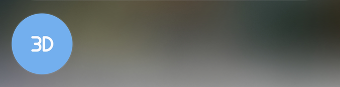

- **누르면** 화면 3D가 시작됩니다. 화면 공유 창에서 **"앱 하나 공유"**로 두고 3D로 볼 앱을 고릅니다. 자세한 순서는 아래 [사용법 4](#사용법)에 있습니다.
- **켜져 있을 때 누르면** 화면 3D가 끝납니다. 켜져 있는 동안에는 타일이 켜진 색으로 보입니다.
- **타일 넣는 법**: DepthFlix를 설치해도 타일이 저절로 생기지는 않습니다. 안드로이드는 앱이 타일을 스스로 넣지 못하게 하기 때문입니다. 아래 둘 중 하나로 직접 넣습니다.
  - DepthFlix를 처음 열 때 뜨는 타일 추가 창에서 **추가**를 누릅니다.
  - 빠른 설정 창의 **편집**(연필 모양) 화면에서 **DepthFlix › 3D**를 찾아 끌어다 놓습니다.

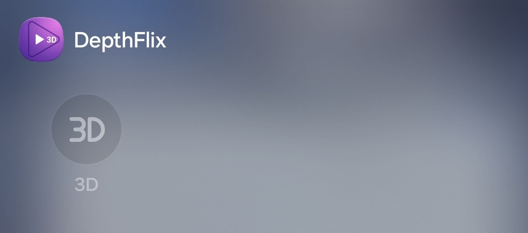

### v1.5.0에서 바뀐 것

- **화면 3D (새 기능)**: 유튜브 같은 **다른 앱에 뜬 SBS 영상을 그 자리에서 3D로** 봅니다. 영상을 내려받거나 DepthFlix로 보낼 필요가 없습니다. 일반 2D 화면도 **AI 3D**로 볼 수 있습니다. 사용법은 아래 [4. 다른 앱 화면을 3D로](#사용법)에 있습니다.
  - 빠른 설정의 **3D 타일**이나 목록 화면의 **화면 3D** 버튼으로 켭니다.
  - 3D로 보는 중에 화면을 오른쪽에서 왼쪽으로 밀면 메뉴가 나옵니다: 방식(SBS 3D / AI 3D) · 원본 · 화면 비 · 밝기 · 대비 · 위상 · 3D 끄기.
  - S25 Ultra에서 캡처와 그리기 모두 초당 120프레임으로 측정됐습니다.
- **3D 맞추기 버튼은 가로 화면에서만 보입니다.** 줄 맞추기는 처음 한 번만 하면 되고 어차피 가로로 들고 하는 도구라, 세로 화면의 버튼 줄에서는 뺐습니다. 폰을 가로로 돌리면 나타납니다.

### v1.4.3에서 바뀐 것

- **사진을 밀어서 넘기기**: 사진을 보다가 화면을 왼쪽으로 밀면 다음 사진, 오른쪽으로 밀면 이전 사진입니다. 밀어서 넘길 때는 파일 이름 알림이 뜨지 않아 그림만 이어서 볼 수 있습니다. ◀◀ ▶▶ 버튼은 예전처럼 이름을 보여 줍니다.

### v1.4.2에서 바뀐 것

- **거리에 따른 3D 보정**: 가까이 보거나 멀리 볼 때 화면 양쪽 끝의 3D가 어긋나던 것을 고쳤습니다. 화면 가운데뿐 아니라 가장자리까지 고르게 맞습니다.
  - S25 Ultra를 거울 앞에 세우고 앞카메라로 28~43 cm 거리에서 직접 재서 구한 값입니다. 43 cm에서 화면 좌우의 위상 차이가 0.22주기에서 0.01주기로 줄었습니다.
  - 업데이트 후 화면 끝이 전보다 어긋나 보이면 **3D 맞추기 › 가로·세로 줄 맞추기**를 한 번 다시 해 주세요.
- **처음 값으로**: 누르면 먼저 묻고, 바로 다음 창에서 **되돌리기**도 할 수 있습니다.

### v1.4.0에서 바뀐 것

- **AI 깊이로 2D→3D**: 2D 영상·사진의 입체감을 AI가 만듭니다. 화면 전체가 비스듬히 기울던 예전 방식과 달리, 사람과 물체가 실제 거리대로 앞뒤로 나뉩니다.
  - 물체 가장자리에 실 같은 선이 생기지 않게 다듬었습니다.
  - 장면이 바뀌면 깊이를 바로 새로 잡습니다.
- **사진**:
  - 세로 사진과 캡처 화면이 위아래(TB) 3D로 잘못 판정되던 문제를 고쳤습니다.
  - 카메라로 세로로 찍은 사진(HEIC 포함)이 옆으로 눕지 않고 똑바로 나옵니다.
- **화면 비 "확대해서 채우기"**: 영상 비율 그대로 화면을 꽉 채웁니다. 넘치는 위아래만 잘립니다. 영상마다 따로 기억합니다.
- **재생바**: 화면 맨 아래에 붙습니다.
- **3D 맞추기에서도 밝기·대비**: 3D 맞추기 화면 오른쪽 위에 플레이어와 같은 **3D 조절** 바가 있습니다.
- **유튜브 공유**: 목록이 "사진 보기"에 있어도 공유한 유튜브 링크(실시간 방송 포함)가 영상으로 재생됩니다.
- **3D 조절 바**: 위상을 바꾸고 손을 떼면 1.5초 뒤 저절로 닫힙니다.

### 기능

**3D 보기**

| 기능 | 설명 |
|---|---|
| **화면 3D** | 유튜브 등 **다른 앱의 화면**을 3D로 봅니다. SBS 영상은 그대로, 2D 화면은 AI 깊이로 바꿉니다. 빠른 설정의 **3D** 타일이나 목록의 **화면 3D** 버튼으로 켭니다. 폰 화면 해상도가 3120×1440(WQHD+)이고 앱이 화면 전체를 채울 때만 됩니다. |
| **자동 판별** | SBS·TB(half·full)·2D를 그림의 화소로 판별합니다. 아주 넓은 영상(32:9 등)은 해상도만으로 SBS로 봅니다. 틀리면 설정에서 직접 고르고, **↺ 자동 판별로 되돌리기**로 되돌립니다. |
| **AI 깊이 (2D→3D)** | 2D 영상·사진은 AI 깊이로 3D가 됩니다. 아래 재생바의 **AI 깊이 켜짐/꺼짐** 버튼으로 끄면 예전 기울기 방식이 됩니다(모든 영상에 공통으로 기억). 입체감 세기는 설정의 **깊이** 슬라이더로 조절합니다. 모델을 불러오는 첫 1초 남짓, 또는 모델을 쓸 수 없을 때는 예전 기울기 방식으로 보입니다. |
| **3D ↔ 2D** | 화면을 한 번 터치하면 3D와 2D가 바뀝니다. 2D일 때는 카메라(눈 추적)도 꺼집니다. |
| **사진** | 목록 위 **사진 보기**로 바꾸면 폴더별 사진을 3D로 봅니다. 아래 ◀◀ ▶▶로 이전·다음 사진으로 넘깁니다. 화면을 **좌우로 밀어도** 넘어갑니다(왼쪽으로 밀면 다음 사진). 밀어서 넘길 때는 파일 이름이 뜨지 않습니다. |

**화면**

| 기능 | 설명 |
|---|---|
| **화면 비** | 설정 › **화면 비** 버튼을 누를 때마다 바뀝니다: 자동 → **확대해서 채우기** → 16:9 → 2.40:1 → 1.85:1 → 4:3 → 꽉 채우기(늘리기). 영상마다 따로 기억합니다. |
| **화면 비 미세조정** | 슬라이더로 1.00~3.00:1 사이를 직접 맞춥니다. 비율 정보가 틀린 영상용입니다. |
| **밝기·대비 보정** | 필름 3D는 각 눈에 화소 일부만 가서 어둡습니다. 기본으로 밝기 1.4, 대비 1.15로 올립니다. 3D 조절 바에서 바꿀 수 있습니다. |
| **정중앙 배치** | 카메라 구멍과 상관없이 그림을 화면 정중앙에 같은 여백으로 놓습니다. |

**3D 조절 바** (재생 중 오른쪽 위 **3D 조절**)

| 항목 | 언제 |
|---|---|
| **위상** | 그림이 겹치거나 앞뒤가 뒤집혀 보일 때. 천천히 움직여 가장 선명한 곳에 둡니다. |
| **추적** | 고개를 옆으로 움직일 때 3D가 깨질 때 (1.5~2.5). |
| **밝기 · 대비** | 3D가 어둡거나 흐릴 때. |

값은 저장되고, 3D 맞추기 도구와 같은 값을 씁니다. 위상을 바꾸고 손을 떼면 바는 1.5초 뒤 저절로 닫힙니다.

**설정 패널** (재생 중 아래 **⚙ 설정**)

| 항목 | 설명 |
|---|---|
| **소스** | 2D / SBS / TB(half·full)를 직접 고릅니다. 고른 값은 그 파일에 기억됩니다. |
| **출력** | 3D 출력 / 2D 출력. |
| **좌우반전** | 두 눈 그림을 바꿉니다(앞뒤가 뒤집혀 보이는 SBS용). |
| **깊이** | 2D→3D 입체감 세기. |
| **수렴 보정** | 그림 전체를 화면 앞뒤로 옮깁니다. **수렴 자동**은 장면 중심을 화면 면에 맞춥니다. |
| **자막** | 자막 선택, 크기, 위치(아래에서 올림), 깊이(앞으로 튀어나옴). |
| **오디오 트랙** | 여러 소리 트랙 중 고르기. |
| **파일 삭제** | 보고 있는 파일을 지웁니다(되돌릴 수 없음). |

**여는 곳**

| 기능 | 설명 |
|---|---|
| **폰 안의 영상·사진** | 폴더 목록에서 고릅니다. 자주 여는 폴더는 길게 눌러 위로 고정합니다. 보던 위치에서 이어 봅니다. |
| **USB 드라이브** | 목록 위 **USB**. 처음 한 번 드라이브를 허락하면 폴더·영상·사진을 바로 둘러봅니다. 길게 누르면 다른 드라이브를 고릅니다. |
| **유튜브** | 유튜브 앱에서 **공유 → DepthFlix**, 또는 **URL/스트리밍 열기**에 링크를 붙여 넣습니다. 실시간 방송도 됩니다. 화질과 자막 언어를 고르고, 고른 화질은 다음부터 기본값이 됩니다. |
| **URL · SMB · DLNA** | **URL/스트리밍 열기**에서 스트리밍 주소, 윈도 공유 폴더(SMB), 미디어 서버(DLNA: Plex·Jellyfin 등)를 엽니다. |
| **다른 앱에서** | 갤러리나 파일 앱에서 영상·사진을 "다음으로 열기 → DepthFlix"로 바로 엽니다. |

**자막과 소리**

- 영상 옆의 .srt·.smi 등을 자동으로 붙입니다(USB 포함, 한국어 우선). 없으면 영상 안의 자막을 자동으로 켭니다.
- DTS·AC3 소리도 재생합니다(FFmpeg).

**3D 맞추기 도구** (목록 위 **3D 맞추기**)

- 큰 버튼 하나로 필름 렌즈의 가로·세로 줄을 맞춥니다.
- SBS 사진을 3D로 봅니다. 게임 SBS 스크린샷 6장이 기본으로 들어 있습니다.
- 오른쪽 위 **3D 조절**로 위상·추적·밝기·대비를 맞춥니다.

### 사용법

**1. 처음 한 번: 가로·세로 줄 맞추기**

폰을 **가로로** 들면 목록 화면 위에 **3D 맞추기** 버튼이 보입니다(세로 화면에서는 숨겨집니다). 누르면 2D 화면에 안내가 뜹니다. 기본 사진이 들어 있어 바로 3D를 볼 수 있습니다(길게 눌러 ◀ ▶로 넘기기).


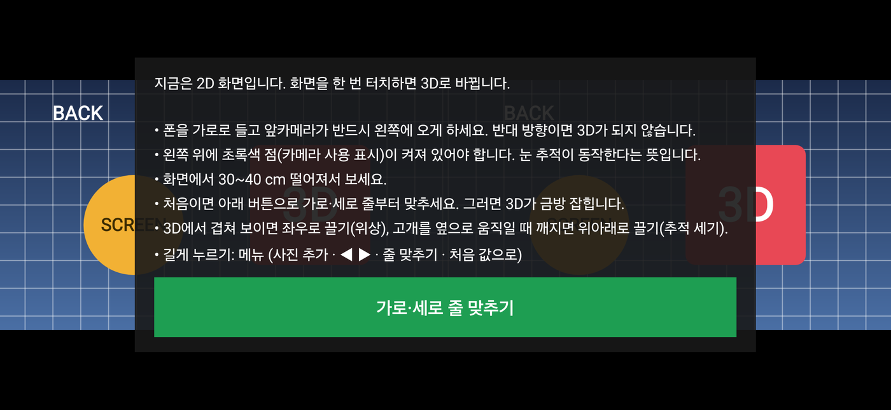

- 폰을 가로로 들고 **앞카메라가 반드시 왼쪽**에 오게 합니다.
- **왼쪽 위의 초록색 점**(카메라 사용 표시)이 켜져 있어야 합니다. 눈 추적이 동작한다는 뜻입니다.
- 화면에서 30~40 cm 떨어져서 큰 초록 버튼 **가로·세로 줄 맞추기**를 누릅니다.

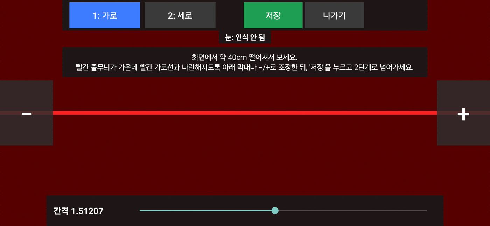

필름을 통해 보이는 빨간 줄무늬가 가운데 선과 **나란해질 때까지** 아래 막대나 −/+로 조정하고 **저장**을 누릅니다. 1단계(가로)와 2단계(세로)를 차례로 하면 끝나고 바로 3D 화면이 됩니다.

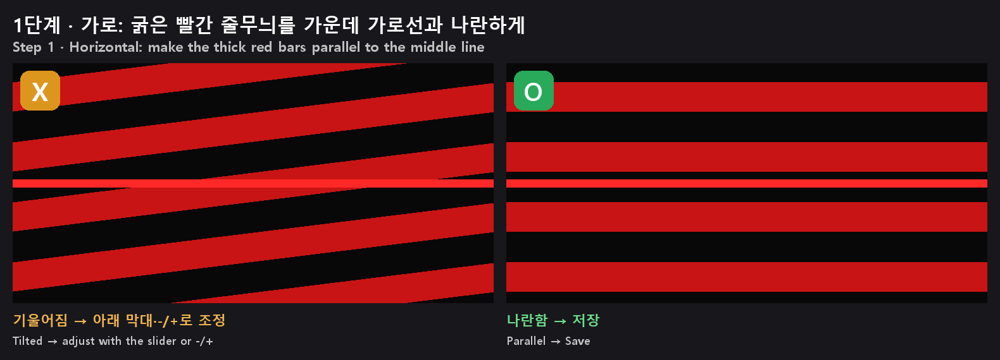

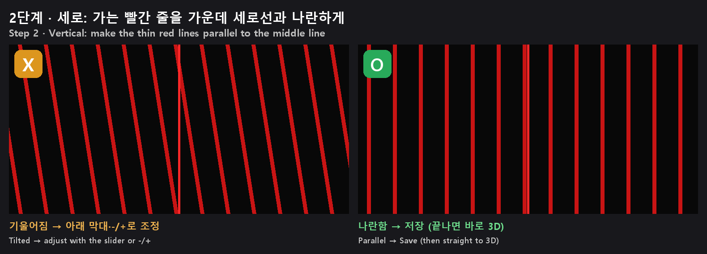

3D 맞추기 화면에서는 **한 손가락으로 꾹(1초) 누르면** 아래에 메뉴가 나옵니다: 사진 추가 · ◀ 이전 / 다음 ▶ · 가로·세로 줄 맞추기 · 처음 값으로 · 닫기.


**2. 보기**

- 목록에서 영상이나 사진을 고르면 3D로 열립니다. 위의 **사진 보기 / 영상 보기**로 목록을 바꿉니다.
- 2D 영상·사진은 AI 깊이로 자동으로 3D가 됩니다. 처음 열 때 모델을 불러오느라 1초쯤 걸립니다(설치 후 맨 처음 한 번은 몇 초). 끄려면 재생바의 **AI 깊이 켜짐** 버튼을 누릅니다.
- 화면 한 번 터치: 3D ↔ 2D. 아래 재생바: 목록 · ◀◀ ▶▶ · 재생 위치 · AI 깊이 켜짐/꺼짐 · ⚙ 설정.
- 16:9 영상을 화면에 꽉 채우려면 ⚙ 설정 › **화면 비**를 "확대해서 채우기"로 바꿉니다.

**3. 보면서 맞추기: 3D 조절**

재생 중 오른쪽 위 **3D 조절**을 누르면 바가 열립니다(위 "3D 조절 바" 표 참고). 엉망이 되면 3D 맞추기 메뉴의 **처음 값으로**를 누릅니다. 한 번 더 묻고, 바로 다음 창에서 **되돌리기**도 할 수 있습니다.


**4. 다른 앱 화면을 3D로: 화면 3D**

유튜브 같은 다른 앱에서 SBS 영상을 틀어 놓고, 그 화면을 그대로 3D로 봅니다.

1. **켜기**: 빠른 설정 창의 **3D** 타일을 누르거나, DepthFlix 목록 화면의 **화면 3D** 버튼을 누릅니다.

   

   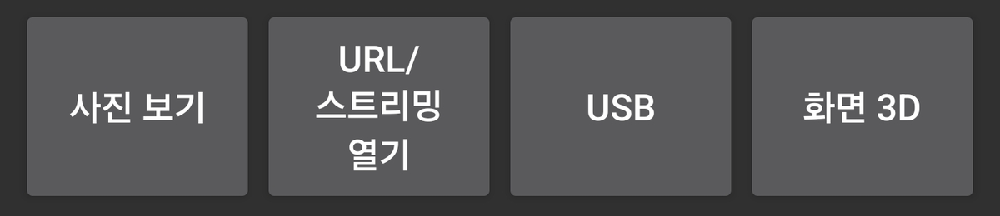

   - 타일은 DepthFlix를 처음 열 때 추가할지 한 번 묻습니다. 안드로이드는 앱이 타일을 스스로 넣지 못하게 하므로, **추가**를 직접 눌러야 합니다. 나중에 넣으려면 빠른 설정의 편집 화면에서 "3D"를 끌어다 놓습니다.
2. **볼 앱 고르기**: 화면 공유 창이 뜨면 **"앱 하나 공유"** 그대로 두고 **다음**을 누른 뒤, 3D로 볼 앱을 고릅니다.
   - "전체 화면 공유"로는 되지 않습니다. 앱이 그린 3D 화면이 다시 캡처되어 가는 선으로 가득 차기 때문입니다. 그렇게 고르면 앱이 알아채고 다시 묻습니다.
3. **3D 켜기**: 그 앱에서 SBS 영상을 전체 화면으로, 폰은 가로(앞카메라 왼쪽)로 두고 화면의 둥근 **3D** 버튼을 누릅니다.

   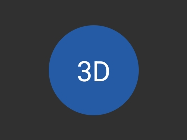

   - 버튼은 끌어서 옮길 수 있습니다. 길게 누르면 화면 3D가 끝납니다(타일을 다시 눌러도 끝납니다).
4. **맞추기**: 3D로 보는 중에 화면을 **오른쪽에서 왼쪽으로 밀면** 오른쪽에 메뉴가 나옵니다. 값을 바꾸면 잠시 뒤 스스로 숨습니다.

   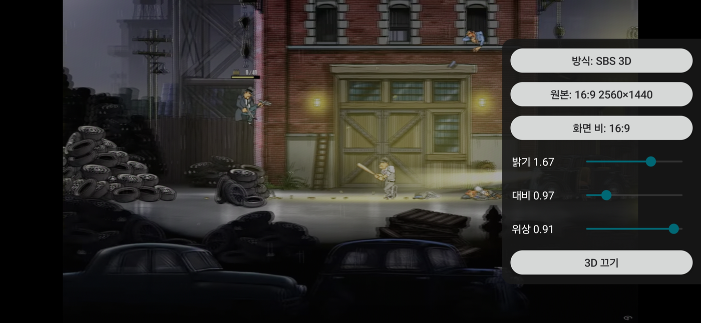

   | 메뉴 | 하는 일 |
   |---|---|
   | **방식** | **SBS 3D**: 좌우로 나란한 영상을 3D로. **AI 3D**: 일반 2D 화면을 AI 깊이로 3D로. |
   | **원본** | 화면의 어느 부분이 SBS 그림인지. **자동**은 양옆·위아래의 띠를 빼고 영상 부분만 찾습니다(16:9 영상이면 2560×1440). 틀리게 잡으면 **16:9**나 **전체**로 고정합니다. |
   | **화면 비** | 플레이어와 같습니다: 자동 → 확대해서 채우기 → 16:9 → 2.40:1 → 1.85:1 → 4:3. |
   | **밝기 · 대비 · 위상** | 슬라이더로 맞춥니다. 플레이어의 3D 조절과 같은 값이라 서로 그대로 적용됩니다. |
   | **3D 끄기** | 3D를 끄고 원래 화면으로 돌아갑니다. |

알아 둘 점:

- **폰 화면 해상도가 3120×1440(WQHD+)**이어야 합니다(설정 › 디스플레이 › 화면 해상도). 필름의 무늬를 화소 하나하나에 맞춰 그리기 때문에 다른 해상도에서는 켜지지 않습니다.
- 보는 앱이 **화면 전체**를 채워야 합니다. 분할 화면이나 팝업 창에서는 켜지지 않습니다.
- 3D로 보는 동안에는 화면을 눌러도 아래 앱이 반응하지 않습니다. 앱을 조작하려면 메뉴의 **3D 끄기**를 누르고, 다시 3D 버튼으로 켭니다.
- 넷플릭스처럼 화면 캡처를 막는 앱의 영상은 볼 수 없습니다.
- 유튜브에서 16:9 영상을 그냥 틀면 양옆에 띠가 생깁니다. **원본: 자동**이 이 띠를 빼고 잡습니다.

### 설치

1. [Releases](../../releases)에서 `DepthFlix-S25Ultra-*.apk`를 받아 설치합니다. AI 모델이 들어 있어 파일이 큽니다.
2. 처음 실행할 때 **저장소** 권한을, 3D를 처음 볼 때 **카메라** 권한(눈 추적용)을 허용합니다.

패키지가 `com.nauty.p3d.glass`라 다른 DepthFlix와 함께 설치할 수 있습니다. 이전 버전 위에 덮어 설치하면 맞춰 둔 값이 그대로 남습니다.

### 잘 보는 법

- **거리 30~40 cm**에서 보세요. 20 cm처럼 너무 가까우면 2D가 됩니다.
- **앞카메라가 왼쪽**에 오게 가로로 듭니다.
- 겹치거나 뒤집혀 보이면 **3D 조절 › 위상**을 천천히 움직여 가장 선명한 곳에 둡니다. 머리를 옆으로 옮길 때 깨지면 **추적**(1.5~2.5)을 조절합니다.
- 2D 영상의 입체감이 너무 세거나 약하면 ⚙ 설정 › **깊이**를 조절합니다.
- 처음 쓰는 폰·필름이면 목록 위 **3D 맞추기** › **가로·세로 줄 맞추기**부터 하세요.

### 빌드

`glassGithub` 플레이버입니다(`app3d/app/src/glass/`).

```
cd app3d
gradlew assembleGlassGithubRelease
```

- github 배포판은 Leia 백엔드도 함께 컴파일하므로 `app3d/app/libs/redmagic/leia-cnsdk*.jar`가 **컴파일에만** 필요합니다. APK에는 들어가지 않고 S25에서는 쓰이지 않습니다.
- AI 깊이 모델은 저장소에 없습니다(약 99MB). 빌드 전에 [depth_anything_v2-tflite-float.zip](https://qaihub-public-assets.s3.us-west-2.amazonaws.com/qai-hub-models/models/depth_anything_v2/releases/v0.67.0/depth_anything_v2-tflite-float.zip)을 받아 `depth_anything_v2.tflite`를 `app3d/app/src/glass/assets/depth/`에 넣으세요.
- 필름 렌즈 값(간격 1.51207, 기울기 −0.19057)은 S25 Ultra(SM-S938N)에서 측정한 값입니다.

Leia 태블릿용 원래 설명: [docs/README.leia.ko.md](docs/README.leia.ko.md)

---

## English

The **Galaxy S25 Ultra + SpatialGlass 3D film** edition of [DepthFlix](https://github.com/nautymac/DepthFlix) (originally for Leia tablets). Watch in 3D on the phone, without glasses:

- SBS and TB 3D videos and photos, as they are.
- Ordinary 2D videos and photos, turned into 3D by AI.
- **Another app's screen** (YouTube, for example), turned 3D right where it is (Screen 3D).

The film is **only a lens**: the phone has no 3D engine, so the app does three things itself. All of it happens on the phone; no camera image or photo leaves it.

- **Weaving**: both eyes' pictures are mixed per pixel to match the film's lenses, with blending curves measured separately for red, green and blue.
- **Eye tracking**: the front camera finds both irises about 60 times a second and moves the weave with your head, so 3D holds as you move.
- **AI depth**: for 2D videos and photos an AI model (Depth Anything V2) reads the depth of the scene and builds the two eyes' pictures, about 35 ms a frame on the S25 Ultra's NPU (its AI chip).

### The 3D tile in Quick Settings

Put the **3D** tile in the Quick Settings panel (swipe down from the top of the screen) and you can turn the app you are watching, YouTube for example, into 3D without opening DepthFlix.


- **Tap it** and Screen 3D starts. In the screen-sharing window leave **"Share one app"** and choose the app to watch in 3D. The full steps are in [How to use, 4](#how-to-use) below.
- **Tap it while it is on** and Screen 3D ends. The tile is shown lit while Screen 3D is running.
- **Adding the tile**: installing DepthFlix does not put the tile there by itself, because Android does not let an app add its own tile. Add it one of these two ways.
  - Tap **Add** in the window that appears the first time DepthFlix opens.
  - In the panel's **edit** screen (the pencil), find **DepthFlix › 3D** and drag it in.


### What's new in v1.5.0

- **Screen 3D (new)**: watch a **side-by-side video playing in another app**, such as YouTube, **in 3D where it is**. No downloading, no sending it to DepthFlix. An ordinary 2D screen can be watched in **AI 3D** too. See [4. Another app's screen in 3D](#how-to-use) below.
  - Start it from the **3D tile** in Quick Settings or the **Screen 3D** button on the list screen.
  - While in 3D, swipe from right to left for the menu: mode (SBS 3D / AI 3D) · source · aspect · brightness · contrast · phase · 3D off.
  - Measured on the S25 Ultra: capture and drawing both at 120 frames a second.
- **The 3D setup button shows in landscape only.** Lining up the lens is done once, and the tool is used in landscape anyway, so the button is left out of the row in portrait. Turn the phone to landscape and it appears.

### What's new in v1.4.3

- **Swipe through photos**: while viewing a photo, swipe left for the next one and right for the previous one. A swipe does not pop up the file name, so you see only the pictures. The ◀◀ ▶▶ buttons still show the name.

### What's new in v1.4.2

- **3D corrected for viewing distance**: the left and right edges of the screen no longer drift out of 3D when you watch from closer or farther away. The whole screen lines up, not only the middle.
  - Measured on an S25 Ultra facing a mirror, its front camera reading the screen from 28–43 cm. At 43 cm the phase difference across the screen went from 0.22 to 0.01 of a lens period.
  - If the edges look worse after the update, run **3D setup › Line up the lens** once more.
- **Reset to defaults** asks first, and the next window offers **Undo**.

### What's new in v1.4.0

- **2D→3D by AI depth**: 2D videos and photos get their depth from AI. People and objects now sit at their real distances, instead of the whole picture tilting as before.
  - Edges are smoothed so no thin lines appear around objects.
  - On a scene cut the depth starts over at once.
- **Photos**:
  - Portrait photos and screenshots are no longer mistaken for top-bottom (TB) 3D.
  - Camera photos taken upright (HEIC too) show upright, not on their side.
- **Aspect "zoom to fill"**: fills the screen keeping the video's own shape; only what spills over (top and bottom) is cut. Remembered per file.
- **Play bar**: sits at the very bottom of the screen.
- **Brightness and contrast in 3D setup**: the same **3D tune** bar as the player, top right in 3D setup.
- **YouTube sharing**: a shared YouTube link (live streams too) plays as video even while the list shows photos.
- **3D tune bar**: closes by itself 1.5 s after you change the phase and lift your finger.

### Features

**Watching in 3D**

| Feature | What it does |
|---|---|
| **Screen 3D** | Watch **another app's screen** (YouTube and so on) in 3D: SBS videos as they are, 2D screens by AI depth. Start it from the **3D** tile in Quick Settings or the **Screen 3D** button on the list. Works only with the phone's screen resolution at 3120×1440 (WQHD+) and the app filling the screen. |
| **Auto detection** | Tells SBS, TB (half and full) and 2D apart from the pixels; very wide videos (32:9 and the like) are SBS by their size alone. If it is wrong, pick the layout in Settings; **↺ Back to automatic detection** undoes that. |
| **AI depth (2D→3D)** | 2D videos and photos get their 3D from AI depth. The **AI depth on/off** button on the play bar switches it off for the old tilt (one choice for every video). Set the strength with the **Depth** slider in Settings. For the first second or so while the model loads, or if it cannot run, the old tilt is used. |
| **3D ↔ 2D** | Tap the screen once. In 2D the camera (eye tracking) is off too. |
| **Photos** | Switch the list to **Photos** to browse photo folders in 3D; ◀◀ ▶▶ at the bottom go to the previous/next photo. You can also **swipe left or right** on the picture (left = next); a swipe does not pop up the file name. |

**Picture**

| Feature | What it does |
|---|---|
| **Aspect** | Settings › **Aspect** steps through: auto → **zoom to fill** → 16:9 → 2.40:1 → 1.85:1 → 4:3 → fill (stretch). Remembered per file. |
| **Aspect fine-tune** | A slider from 1.00 to 3.00:1, for videos whose aspect information is wrong. |
| **Brightness and contrast lift** | Film 3D is dimmer because each eye gets only part of the pixels. Lifted by default (brightness 1.4, contrast 1.15); change it on the 3D tune bar. |
| **Dead-centre placement** | The picture sits in the exact centre of the panel with equal bars, whatever the camera cutout does to the window. |

**3D tune bar** (while playing, **3D tune** at the top right)

| Item | When |
|---|---|
| **Phase** | The picture looks doubled or inside-out. Slide slowly to the sharpest point. |
| **Track** | 3D breaks when you move your head sideways (1.5–2.5). |
| **Bright · Contrast** | 3D looks dim or flat. |

Saved, and shared with the 3D setup tool. After a phase change the bar closes by itself 1.5 s after you lift your finger.

**Settings panel** (while playing, **⚙ Settings** at the bottom)

| Item | What it does |
|---|---|
| **Source** | Pick 2D / SBS / TB (half, full) by hand; remembered for that file. |
| **Output** | 3D or 2D output. |
| **Swap L/R** | Swaps the two eyes' pictures (for SBS that looks inside-out). |
| **Depth** | Strength of the 2D→3D depth. |
| **Convergence** | Moves the whole picture in front of or behind the screen; **Auto convergence** puts the centre of the scene on the screen plane. |
| **Subtitles** | Choose, size, position (raise from the bottom), depth (how far they float out). |
| **Audio track** | Choose among sound tracks. |
| **Delete file** | Deletes the file being shown (cannot be undone). |

**Where to open things from**

| Feature | What it does |
|---|---|
| **Videos and photos on the phone** | Pick from the folder list; long-press a folder to pin it to the top. Videos resume where you left off. |
| **USB drives** | The **USB** button above the list. Allow the drive once, then browse its folders, videos and photos. Long-press to pick another drive. |
| **YouTube** | In the YouTube app, **Share → DepthFlix**, or paste the link in **Open URL / stream**. Live streams work. Pick the quality and subtitle language; the quality you pick becomes the default. |
| **URL · SMB · DLNA** | **Open URL / stream** opens a stream address, a Windows shared folder (SMB) or a media server (DLNA: Plex, Jellyfin and others). |
| **From other apps** | "Open with → DepthFlix" a video or photo from the gallery or a file manager. |

**Subtitles and sound**

- Subtitle files next to the video (.srt, .smi and others) are picked up automatically (USB included, Korean first); otherwise the video's built-in subtitles are turned on.
- DTS and AC3 sound play too (FFmpeg).

**3D setup tool** (**3D setup** above the list)

- Lines up the film's lenses (horizontal and vertical) with one big button.
- Shows SBS photos in 3D; six SBS game screenshots come built in.
- **3D tune** at the top right sets phase, track, brightness and contrast.

### How to use

**1. Once: line up the lens (horizontal and vertical lines)**

Hold the phone **in landscape** and **3D setup** appears at the top of the list screen (it is hidden in portrait). Tap it: it opens in 2D with a short guide; built-in pictures give you 3D to look at right away (long-press, then ◀ ▶).

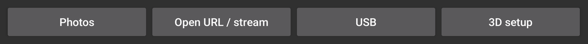

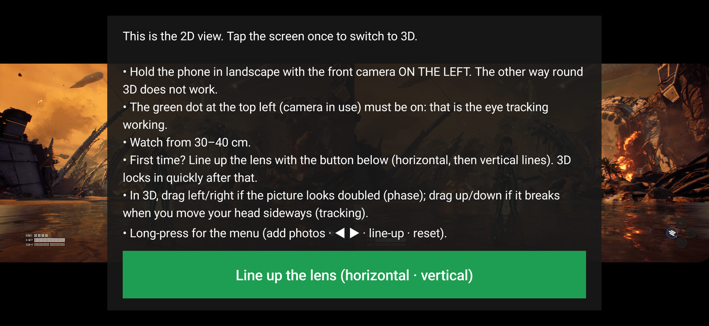

- Hold the phone in landscape with the **front camera on the left**, always.
- The **green dot at the top left** (camera in use) must be on: that is the eye tracking working.
- From 30–40 cm, tap the big green button **Line up the lens**.

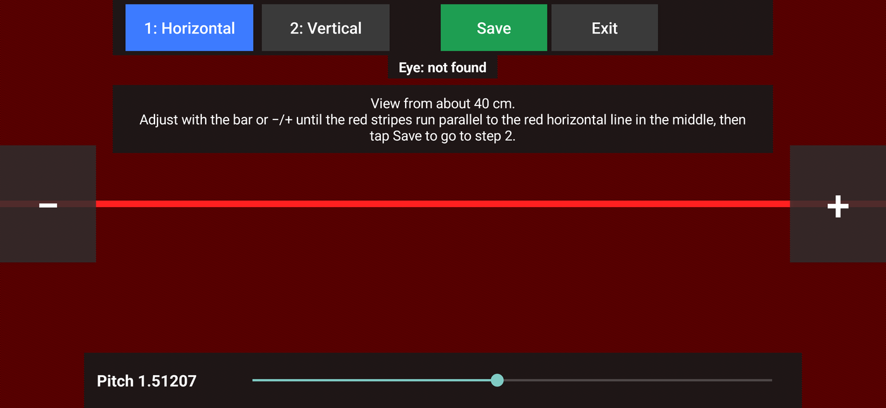

Adjust with the slider or −/+ until the red stripes you see through the film run **parallel to the middle line**, then tap **Save**. Step 1 (horizontal) then step 2 (vertical); after step 2 it goes straight to 3D.


In 3D setup, **press and hold one finger (about 1 s)** for the menu at the bottom: add photos · ◀ prev / next ▶ · line up the lens · reset to defaults · close.

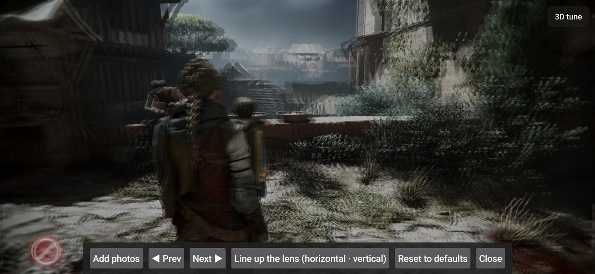

**2. Watching**

- Pick a video or photo from the list and it opens in 3D. **Photos / Videos** at the top switches the list.
- 2D videos and photos turn 3D by AI depth on their own. Loading the model takes about a second (a few seconds the very first time after installing). To turn it off, tap **AI depth on** on the play bar.
- Tap once: 3D ↔ 2D. The bar at the bottom: list · ◀◀ ▶▶ · position · AI depth on/off · ⚙ Settings.
- To fill the screen with a 16:9 video, set ⚙ Settings › **Aspect** to "zoom to fill".

**3. Fine-tuning while watching: 3D tune**

While playing, tap **3D tune** at the top right (see the "3D tune bar" table above). If things get messed up: **Reset to defaults** in the 3D setup menu. It asks first, and the next window offers **Undo**.

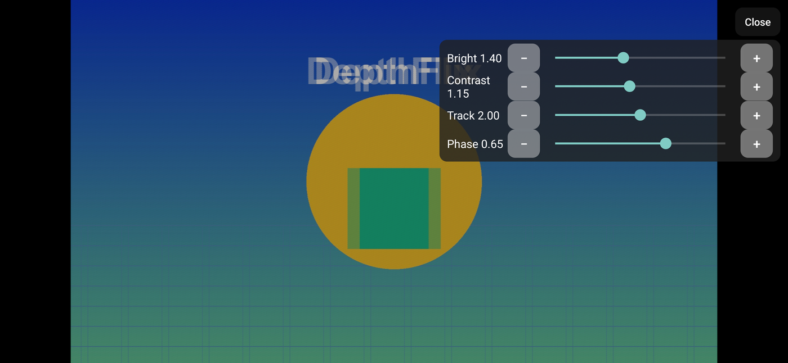

**4. Another app's screen in 3D: Screen 3D**

Play a side-by-side video in another app such as YouTube, and watch that screen in 3D as it is.

1. **Start**: tap the **3D** tile in the Quick Settings panel, or the **Screen 3D** button on the DepthFlix list screen.

   

   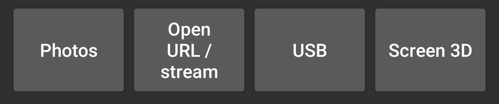

   - The first time DepthFlix opens it asks once whether to add the tile. Android does not let an app add its own tile, so you have to tap **Add** yourself. To add it later, drag "3D" in from the panel's edit screen.
2. **Pick the app**: when the screen-sharing window appears, leave it on **"Share one app"**, tap **Next**, and choose the app to watch in 3D.
   - "Share entire screen" does not work: the 3D picture the app draws would be captured again and fill the screen with thin lines. If you choose it, the app notices and asks again.
3. **Turn 3D on**: in that app, play the SBS video full screen, hold the phone in landscape (front camera on the left) and tap the round **3D** button on the screen.

   

   - The button can be dragged anywhere. A long press ends Screen 3D (so does tapping the tile again).
4. **Adjust**: while in 3D, **swipe from right to left** and a menu comes in on the right. It hides itself shortly after you change something.

   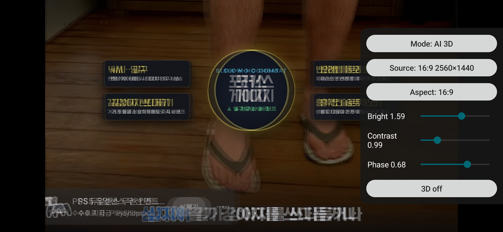

   | Menu | What it does |
   |---|---|
   | **Mode** | **SBS 3D**: a side-by-side video in 3D. **AI 3D**: an ordinary 2D screen in 3D by AI depth. |
   | **Source** | Which part of the screen is the SBS picture. **Auto** leaves out the bars beside or above it and finds the video itself (2560×1440 for a 16:9 video). If it gets it wrong, fix it to **16:9** or **Full**. |
   | **Aspect** | As in the player: auto → zoom to fill → 16:9 → 2.40:1 → 1.85:1 → 4:3. |
   | **Brightness · Contrast · Phase** | Sliders. They are the same values as the player's 3D tune, so each applies to the other. |
   | **3D off** | Turns 3D off and shows the app again. |

Good to know:

- The phone's **screen resolution must be 3120×1440 (WQHD+)** (Settings › Display › Screen resolution). The film's pattern is drawn pixel by pixel, so it does not turn on at other resolutions.
- The app you watch must fill the **whole screen**. It does not turn on in split screen or a pop-up window.
- While in 3D, touches do not reach the app underneath. To use the app, tap **3D off** in the menu, then turn it back on with the 3D button.
- Videos in apps that block screen capture (Netflix and the like) cannot be watched this way.
- YouTube shows a 16:9 video with bars at the sides. **Source: Auto** leaves those out.

### Install

1. Download `DepthFlix-S25Ultra-*.apk` from [Releases](../../releases) and install it. It is large because the AI model is inside.
2. Allow **storage** on first launch and the **camera** (eye tracking) the first time you watch in 3D.

Its package is `com.nauty.p3d.glass`, so it installs next to other DepthFlix builds. Installed over an earlier version, your settings are kept.

### Getting a good picture

- Watch from **30–40 cm**. Much closer (about 20 cm) it turns 2D.
- Hold the phone in landscape with the **front camera on the left**.
- If the picture looks doubled or inside-out, slide **3D tune › Phase** slowly to the sharpest point. If it breaks as you move your head sideways, adjust **Track** (1.5–2.5).
- If the depth of a 2D video is too strong or too weak, change ⚙ Settings › **Depth**.
- On a new phone or film, start with **3D setup** › **Line up the lens**.

### Build

It is the `glassGithub` flavour (`app3d/app/src/glass/`).

```
cd app3d
gradlew assembleGlassGithubRelease
```

- The github distribution also compiles the Leia backend, so `app3d/app/libs/redmagic/leia-cnsdk*.jar` is needed **at compile time only**; it is not packaged and never used on the S25.
- The AI depth model is not in the repository (about 99 MB). Before building, download [depth_anything_v2-tflite-float.zip](https://qaihub-public-assets.s3.us-west-2.amazonaws.com/qai-hub-models/models/depth_anything_v2/releases/v0.67.0/depth_anything_v2-tflite-float.zip) and put `depth_anything_v2.tflite` in `app3d/app/src/glass/assets/depth/`.
- The film's lens values (pitch 1.51207, slant −0.19057) were measured on an S25 Ultra (SM-S938N).

Original Leia tablet documentation: [docs/README.leia.en.md](docs/README.leia.en.md)

---

### Third-party / 사용한 외부 구성 요소

- **Depth Anything V2 Small** — Apache-2.0 ([DepthAnything/Depth-Anything-V2](https://github.com/DepthAnything/Depth-Anything-V2)); TFLite export by Qualcomm AI Hub ([qualcomm/Depth-Anything-V2](https://huggingface.co/qualcomm/Depth-Anything-V2), MIT).
- **LiteRT** (Google) — Apache-2.0.
- **Qualcomm QNN delegate and runtime** (`com.qualcomm.qti:qnn-litert-delegate`, `qnn-runtime`) — included in the app under the Qualcomm AI Hub Model License; the license text ships in the app as `assets/qualcomm-qnn-LICENSE.pdf`.
- **MediaPipe** face landmarker (eye tracking) — Apache-2.0.
- **FFmpeg** (DTS/AC3 audio), **ExoPlayer/Media3**, **yt-dlp** (via youtubedl-android) — see their licenses.

---

Not affiliated with Samsung, the film's maker or Leia.
