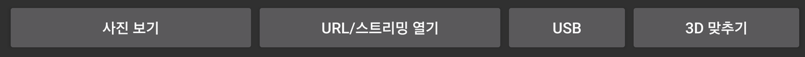
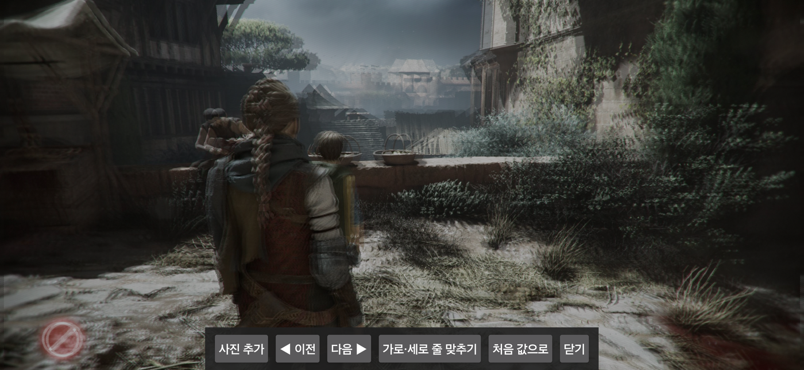
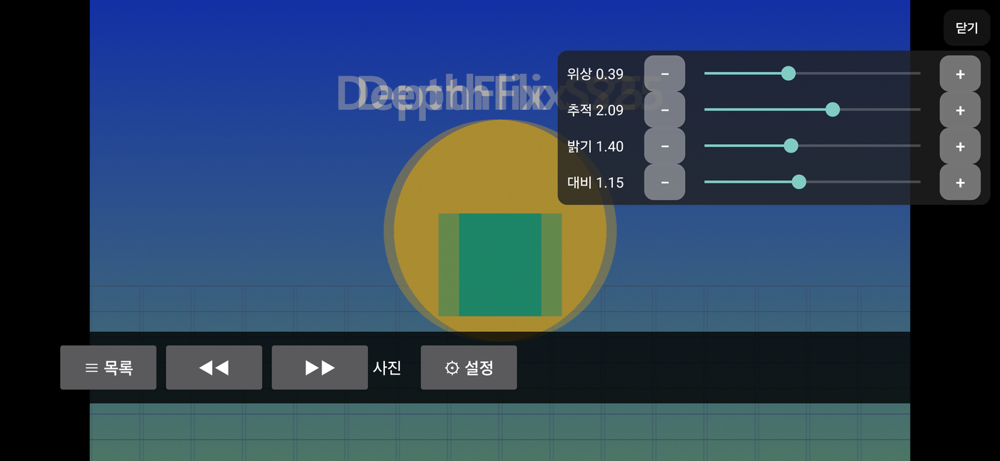

# DepthFlix — S25 Ultra

**3D video and photo player for the Galaxy S25 Ultra with a SpatialGlass 3D film**
**갤럭시 S25 Ultra + SpatialGlass 3D 필름용 3D 영상·사진 플레이어**

*[한국어](#한국어) · [English](#english)*

---

## 한국어

Leia 태블릿용 [DepthFlix](https://github.com/nautymac/DepthFlix)의 **갤럭시 S25 Ultra + SpatialGlass 3D 필름** 버전입니다. SBS·TB 3D 영상과 사진, 그리고 일반 2D 영상을 폰에서 안경 없이 3D로 봅니다.

이 필름은 **렌즈일 뿐**이라 폰에 3D 엔진이 없습니다. 그래서 앱이 직접 합니다.

- **위빙**: 두 눈 그림을 화소마다 필름 렌즈에 맞춰 섞습니다. 색(빨강·초록·파랑)마다 따로 측정한 섞기 곡선을 씁니다.
- **눈 추적**: 앞카메라로 두 눈의 홍채를 초당 약 60번 찾아, 머리를 움직여도 3D가 유지되게 위빙을 옮깁니다. 기기 안에서만 처리합니다.

### 기능

| 기능 | 설명 |
|---|---|
| **3D 영상·사진** | SBS/TB(half·full)를 화소로 판별해 3D로 보여 줍니다. 2D 영상은 시차를 만들어 3D로 봅니다. |
| **3D 조절 바** | 재생 중 오른쪽 위 **3D 조절** → 위상·추적 세기·밝기·대비를 보면서 맞춥니다. 값은 저장됩니다. |
| **밝기·대비 보정** | 필름 3D는 각 눈에 화소 일부만 가서 어둡습니다. 기본으로 밝기 1.4, 대비 1.15로 올립니다(조절 가능). |
| **정중앙 배치** | 카메라 구멍과 상관없이 그림을 화면 정중앙에 같은 여백으로 놓습니다. |
| **USB 드라이브** | 목록 위 **USB** 버튼. 처음 한 번 드라이브를 허락하면 폴더·영상·사진을 바로 둘러보고 3D로 엽니다. 버튼을 길게 누르면 다른 드라이브를 고릅니다. |
| **자막** | 영상 옆의 .srt/.smi 등을 자동으로 붙입니다(USB 포함, 한국어 우선). 없으면 영상 안의 자막을 자동으로 켭니다. |
| **3D 맞추기** | 목록 위 **3D 맞추기** 버튼: 2D 안내 화면에서 큰 버튼 하나로 가로·세로 줄을 맞추고, SBS 사진을 3D로 봅니다. 플레이어와 같은 값을 씁니다. |
| **그 밖에** | SMB·DLNA·URL 재생, DTS·AC3 소리 재생(FFmpeg), 이어 보기 등 DepthFlix 기능 그대로. |

### 사용법

**1. 처음 한 번: 가로·세로 줄 맞추기**

목록 화면 위의 **3D 맞추기** 버튼을 누르면 2D 화면에 안내가 뜹니다. 게임 SBS 스크린샷 6장이 기본 사진으로 들어 있어 바로 3D를 볼 수 있습니다(길게 눌러 ◀ ▶로 넘기기).




- 폰을 가로로 들고 **앞카메라가 반드시 왼쪽**에 오게 합니다.
- **왼쪽 위의 초록색 점**(카메라 사용 표시)이 켜져 있어야 합니다. 눈 추적이 동작한다는 뜻입니다.
- 화면에서 30~40 cm 떨어져서 큰 초록 버튼 **가로·세로 줄 맞추기**를 누릅니다.


필름을 통해 보이는 빨간 줄무늬가 가운데 선과 **나란해질 때까지** 아래 막대나 −/+로 조정하고 **저장**을 누릅니다. 1단계(가로)와 2단계(세로)를 차례로 하면 끝나고 바로 3D 화면이 됩니다.


**2. 보기**

- 화면을 **한 번 터치**하면 3D ↔ 2D가 바뀝니다.
- **한 손가락으로 화면을 꾹(1초) 누르면** 아래에 메뉴가 나옵니다: 사진 추가 · ◀ 이전 / 다음 ▶ · 가로·세로 줄 맞추기 · 처음 값으로 · 닫기.



- 영상·사진은 목록에서 고르면 3D로 열립니다. USB는 목록 위 **USB** 버튼.

**3. 보면서 맞추기: 3D 조절**

재생 중 오른쪽 위 **3D 조절**을 누르면 바가 열립니다.



| 항목 | 언제 |
|---|---|
| **위상** | 그림이 겹치거나 앞뒤가 뒤집혀 보일 때. 천천히 움직여 가장 선명한 곳에 둡니다. |
| **추적** | 고개를 옆으로 움직일 때 3D가 깨질 때 (1.5~2.5). |
| **밝기 · 대비** | 3D가 어둡거나 흐릴 때. |

값은 저장되고, 3D 맞추기 도구와 같은 값을 씁니다. 엉망이 되면 3D 맞추기 메뉴의 **처음 값으로**.

위상을 조절하고 손을 떼면 바는 1.5초 뒤 저절로 닫힙니다.

### 설치

1. [Releases](../../releases)에서 `DepthFlix-S25Ultra-*.apk`를 받아 설치합니다.
2. 처음 실행할 때 **저장소** 권한을, 3D를 처음 볼 때 **카메라** 권한(눈 추적용)을 허용합니다.

패키지가 `com.nauty.p3d.glass`라 다른 DepthFlix와 함께 설치할 수 있습니다.

### 잘 보는 법

- **거리 30~40 cm**에서 보세요. 20 cm처럼 너무 가까우면 2D가 됩니다.
- **앞카메라가 왼쪽**에 오게 가로로 듭니다.
- 겹치거나 뒤집혀 보이면 **3D 조절 › 위상**을 천천히 움직여 가장 선명한 곳에 둡니다. 머리를 옆으로 옮길 때 깨지면 **추적**(1.5~2.5)을 조절합니다.
- 처음 쓰는 폰·필름이면 목록 위 **3D 맞추기** › **가로·세로 줄 맞추기**부터 하세요(위 사용법 1).

### 빌드

`glassGithub` 플레이버입니다(`app3d/app/src/glass/`).

```
cd app3d
gradlew assembleGlassGithubDebug
```

github 배포판은 Leia 백엔드도 함께 컴파일하므로 `app3d/app/libs/redmagic/leia-cnsdk*.jar`가 **컴파일에만** 필요합니다(APK에는 들어가지 않고 S25에서는 쓰이지 않습니다). 필름 렌즈 값(간격 1.51207, 기울기 −0.19057)은 S25 Ultra(SM-S938N)에서 측정한 값입니다.

Leia 태블릿용 원래 설명: [docs/README.leia.ko.md](docs/README.leia.ko.md)

---

## English

The **Galaxy S25 Ultra + SpatialGlass 3D film** edition of [DepthFlix](https://github.com/nautymac/DepthFlix) (originally for Leia tablets). Watch SBS/TB 3D videos and photos, and ordinary 2D videos, in 3D on the phone without glasses.

The film is **only a lens**: the phone has no 3D engine. So the app does it itself:

- **Weaving**: both eyes' pictures are mixed per pixel to match the film's lenses, with blending curves measured separately for red, green and blue.
- **Eye tracking**: the front camera finds both irises about 60 times a second and moves the weave with your head, so 3D holds as you move. Processed on the phone only.

### Features

| Feature | What it does |
|---|---|
| **3D videos and photos** | Detects SBS/TB (half and full) from the pixels and shows them in 3D; 2D videos get synthetic parallax. |
| **3D tune bar** | While playing, tap **3D tune** (top right) to adjust phase, tracking strength, brightness and contrast while watching. Saved. |
| **Brightness and contrast lift** | Film 3D is dimmer because each eye gets only part of the pixels. Lifted by default (brightness 1.4, contrast 1.15), adjustable. |
| **Dead-centre placement** | The picture sits in the exact centre of the panel with equal bars, whatever the camera cutout does to the window. |
| **USB drives** | The **USB** button above the list. Allow the drive once, then browse its folders, videos and photos and open them in 3D. Long-press to pick another drive. |
| **Subtitles** | Picks up .srt/.smi files next to the video automatically (USB included, Korean first); otherwise turns on the video's built-in subtitles. |
| **3D setup (3D Fit)** | The **3D setup** button on the list screen: a 2D guide with one big button to line up the lens (horizontal, vertical), plus an SBS photo viewer; the player uses the same values. |
| **And the rest** | SMB, DLNA and URL playback, DTS/AC3 audio (FFmpeg), resume, and the other DepthFlix features. |

### How to use

**1. Once: line up the lens (horizontal and vertical lines)**

Tap **3D setup** at the top of the list screen. It opens in 2D with a short guide. Six SBS game screenshots come built in, so there is 3D to look at right away (long-press, then ◀ ▶). (The screenshots show the Korean UI; on an English phone the app is in English.)


- Hold the phone in landscape with the **front camera on the left**, always.
- The **green dot at the top left** (camera in use) must be on: that is the eye tracking working.
- From 30–40 cm, tap the big green button **Line up the lens**.


Adjust with the slider or −/+ until the red stripes you see through the film run **parallel to the middle line**, then tap **Save**. Step 1 (horizontal) then step 2 (vertical); after step 2 it goes straight to 3D.


**2. Watching**

- **Tap once** to switch 3D ↔ 2D.
- **Press and hold one finger on the screen (about 1 s)** for the menu at the bottom: add photos · ◀ prev / next ▶ · line up the lens · reset to defaults · close.


- Pick videos and photos from the list and they open in 3D. USB drives: the **USB** button.

**3. Fine-tuning while watching: 3D tune**

While playing, tap **3D tune** at the top right to open the bar.


| Item | When |
|---|---|
| **Phase** | The picture looks doubled or inside-out. Slide slowly to the sharpest point. |
| **Track** | 3D breaks when you move your head sideways (1.5–2.5). |
| **Bright · Contrast** | 3D looks dim or flat. |

Values are saved and shared with the 3D Fit tool. If things get messed up: **Reset to defaults** in the 3D Fit menu.

After a phase change the bar closes by itself 1.5 s after you lift your finger.

### Install

1. Download `DepthFlix-S25Ultra-*.apk` from [Releases](../../releases) and install it.
2. Allow **storage** on first launch and the **camera** (eye tracking) the first time you watch in 3D.

Its package is `com.nauty.p3d.glass`, so it installs next to other DepthFlix builds.

### Getting a good picture

- Watch from **30–40 cm**. Much closer (about 20 cm) it turns 2D.
- Hold the phone in landscape with the **front camera on the left**.
- If the picture looks doubled or inside-out, slide **3D tune › Phase** slowly to the sharpest point. If it breaks as you move your head sideways, adjust **Track** (1.5–2.5).
- On a new phone or film, start with **3D setup** › **Line up the lens** (How to use, step 1).

### Build

It is the `glassGithub` flavour (`app3d/app/src/glass/`).

```
cd app3d
gradlew assembleGlassGithubDebug
```

The github distribution also compiles the Leia backend, so `app3d/app/libs/redmagic/leia-cnsdk*.jar` is needed **at compile time only** (it is not packaged and never used on the S25). The film's lens values (pitch 1.51207, slant −0.19057) were measured on an S25 Ultra (SM-S938N).

Original Leia tablet documentation: [docs/README.leia.en.md](docs/README.leia.en.md)

---

Not affiliated with Samsung, the film's maker or Leia.
